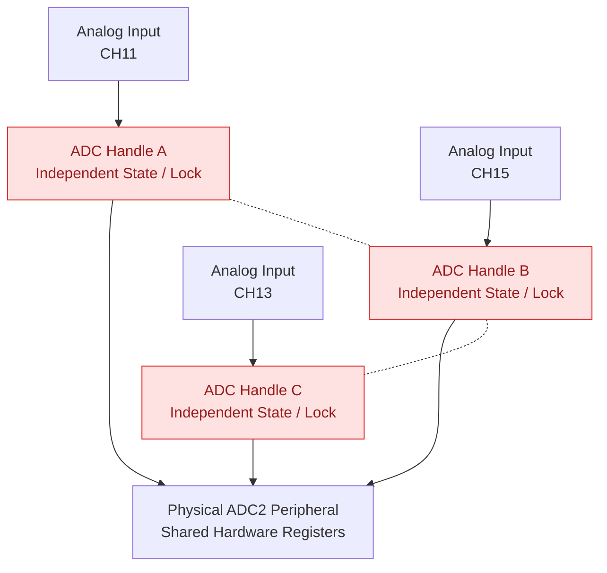
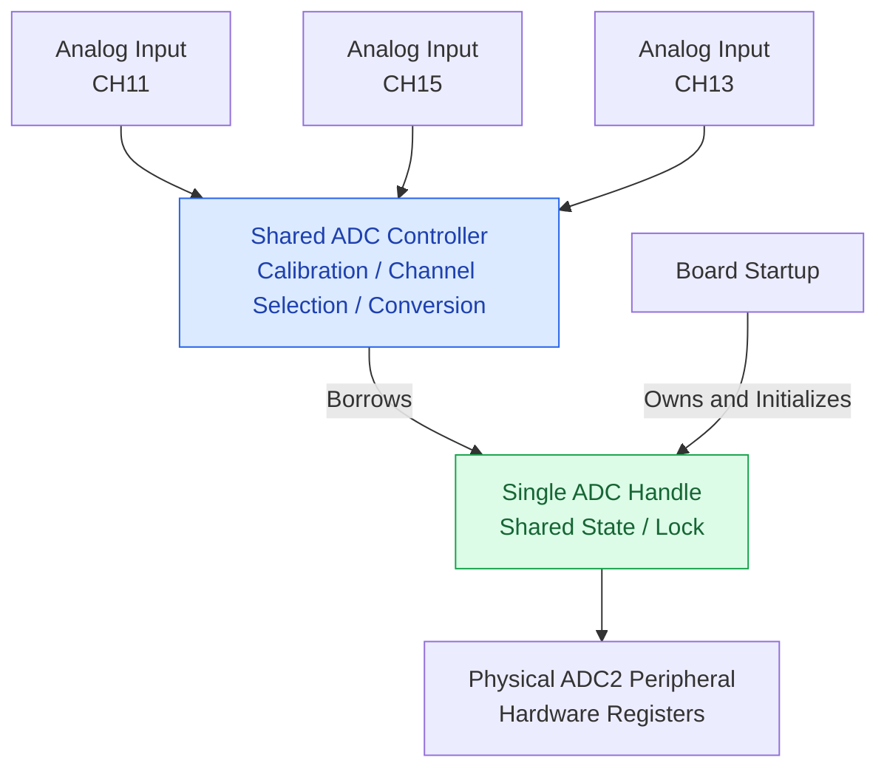

# STM32G4 ADC Module

## Overview

A reusable ADC controller for STM32G4-based boards.

The goal is to centralize ADC calibration, channel selection, and conversion logic so that applications do not need to implement their own ADC handling.

## Motivation & Design

Multiple analog inputs may share the same physical ADC peripheral. Managing ADC operations separately in application or input-specific code can lead to duplicated logic and unclear ownership of the peripheral.

The proposed design introduces one ADC controller per physical ADC peripheral.

### Existing approach



Multiple analog inputs sharing the same physical ADC peripheral may maintain separate HAL handles. Since each handle maintains its own state, lock, and configuration, the software state may become inconsistent with the shared hardware state. ADC initialization, calibration, and conversion logic are also distributed across individual inputs.

### Proposed approach



The proposed design introduces one ADC controller and one HAL handle per physical ADC peripheral. Multiple analog inputs share the controller while retaining their own channel configurations. This centralizes calibration, channel selection, conversion, and error handling, while keeping peripheral initialization and handle ownership at the board level.

The responsibilities are separated as follows:

| Component | Responsibility |
|---|---|
| Board Startup | GPIO, clocks, ADC initialization, and HAL handle ownership |
| ADC Controller | Calibration, channel selection, conversion, and error handling |
| Analog Input | Channel configuration and sensor-specific interpretation |

The controller borrows an existing HAL handle rather than initializing or owning the peripheral. Multiple analog inputs can use the same controller.

## Usage

After board initialization, construct and prepare the controller:

```cpp
AdcControllerSTM32G4XX adc2(hadc2);

auto result = adc2.prepare();
```

Once preparation succeeds, configure and read a channel:

```cpp
ADC_ChannelConfTypeDef channel{};
channel.Channel = ADC_CHANNEL_11;
channel.Rank = ADC_REGULAR_RANK_1;
channel.SamplingTime = ADC_SAMPLETIME_47CYCLES_5;
channel.SingleDiff = ADC_SINGLE_ENDED;
channel.OffsetNumber = ADC_OFFSET_NONE;

uint32_t raw = 0;
result = adc2.read(channel, raw);

if (result.status == AdcStatus::Ok) {
    // Use the raw ADC value.
}
```

Each read follows the STM32 HAL conversion sequence:

`ConfigureChannel → Start → PollForConversion → GetValue → Stop`

The controller also provides `raw_format()` for resolution and oversampling information, and `recalibrate()` when recalibration is required.

## Current Scope

- Blocking, software-triggered, single-shot conversions.
- Single-ended input channels.
- Sequential channel switching on a shared ADC peripheral.
- Configurable resolution and hardware oversampling.
- Conversion timeout, error reporting, and cleanup.

The board must initialize the ADC before calling `prepare()`. The HAL handle must outlive the controller, and its peripheral configuration must remain unchanged after preparation.

Only one controller should manage a physical ADC peripheral. Access must be serialized by the caller.

DMA, interrupt-driven conversions, and concurrent access are not currently supported.

## Build & Test

Host-side unit tests compile the actual ADC controller against a lightweight Fake HAL using the vendor HAL headers.

Requirements: native GCC with C++20 support and CMake 3.20 or later.

From the ADC module directory:

```bash
cmake -S test -B /tmp/adc-host-tests -DCMAKE_BUILD_TYPE=Debug
cmake --build /tmp/adc-host-tests
ctest --test-dir /tmp/adc-host-tests --output-on-failure
```

To view individual test results:

```bash
/tmp/adc-host-tests/adc_host_tests
```

The tests cover controller lifecycle, calibration, configuration validation, shared channel access, conversion failures, timeout recovery, and raw output format calculation.

## Next Steps

- Integrate the controller with `PrimitiveAnalogInputSTM32G4XX`.
- Replace application-specific ADC handling in `PDB_24`.
- Validate calibration, channel switching, and conversion results on STM32 hardware.
- Explore DMA-based acquisition when higher sampling rates are required.